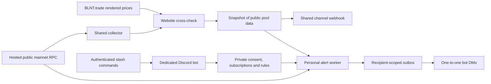

# BLNT Alerts system specification

**Status:** working baseline for user review. This spec consolidates explicit user decisions and current implementation; it is not blanket approval for future changes or activation. Requirement changes should be reviewed by the owner. Repository working procedure is in [AGENTS.md](AGENTS.md).

## 1. Purpose and boundaries

| ID | Requirement and purpose | Acceptance check |
| --- | --- | --- |
| SCOPE-01 | Provide shared BLNT pool updates and opt-in, wallet-specific Discord alerts so members can monitor prices and borrowing conditions without an AI assistant. | Shared updates work without a personal subscription; personal delivery requires consent. |
| SCOPE-02 | Read public data only. No transaction signing/submission, trading, secret-key custody, private/local RPC dependence, AI inference or arbitrary command execution. | RPC endpoint/method allowlists and unsigned getter simulations; no personal OpenClaw integration in either worker. |
| SCOPE-03 | Initially support only the reviewed Fixed V3 and YieldBlent registry. New deployments/assets requiring registry changes need explicit review of identity, denomination and coverage. | `markets.json` and identity/binding tests match the reviewed deployment evidence. |

Liquidity warnings use reserve supply/debt estimates, not a trading-market order-book or volume feed. No general news service, liquidation guarantee, guaranteed execution amount or financial recommendation is provided.

### Architecture and data flow

The bot's command handlers and personal worker are one service; the diagram separates their responsibilities. Shared and personal records currently share a private SQLite database, with logical audience isolation rather than separate physical databases. A snapshot contains public pool data but is a private runtime file, not a public HTTP endpoint. Public wallet addresses are sent to the approved hosted RPC providers for position queries; no wallet keys or AI model are involved. Shared Discord posts must not include those wallet associations or private position results.

## 2. Data integrity and financial meaning

| ID | Requirement | Acceptance check |
| --- | --- | --- |
| DATA-01 | Primary prices come from pinned pool oracles through approved hosted public mainnet RPC providers. The website is a cross-check, not a replacement price source. | Only `PUBLIC_PROVIDERS` in `public-rpc.mjs`; failed oracle collection never substitutes website prices. |
| DATA-02 | Require two healthy mainnet providers agreeing within five ledgers and 30 seconds before selecting a primary. This is agreement on ledger freshness, **not independent agreement on every state value**. | Provider-selection tests reject wrong networks, stale ledgers and disagreement. |
| DATA-03 | Pin pool/oracle WASM identities and bindings. Fail closed on identity, schema, reserve-index or denomination changes. | Collector tests reject changed bindings; exclusions are visible instead of invented prices/rates. |
| DATA-04 | Preserve exact oracle values and fixed-point comparisons. Fixed V3 quotes **USD**; YieldBlent quotes **USDC**. Never assume a peg, convert or combine the two quotes implicitly. | Mixed-decimal fixtures, exact threshold-boundary tests and separate pool labels. |
| DATA-05 | Website checks run initially and every 30 minutes after a match, retrying failures after five minutes. Use displayed rounding plus the configured 0.5% allowance; a match expires after one hour. | Missing/mismatched/expired checks suppress affected price alerts and capacity inputs, including definitely unsent queued price alerts; returning verified coverage can rearm them. |
| DATA-06 | Oracle data may be no older than 15 minutes under the current config. Use public-ledger time plus monotonic elapsed time for freshness; do not infer freshness from host timezone or filesystem modification times. | Future/stale/gapped data tests and slow-recipient regression tests. |
| DATA-07 | Website collection is a fresh isolated browser context, without wallet/session interaction. Permit only approved public HTTPS origins; reject local/private URL or DNS-resolution results, WebSockets and unrelated wallet integrations. This application-level policy is not a claim of kernel-enforced network egress isolation. | Network-policy tests and a matching real cross-check under the service restrictions. |

Pool oracle prices are reference prices, not executable market prices. Reserve `get_reserve` simulations preview current accrual without committing on-chain changes. See [BORROWING_ALERTS.md](BORROWING_ALERTS.md) for the fixed-point capacity/rate definitions and pinned contract evidence.

## 3. Shared updates

| ID | Requirement | Acceptance check |
| --- | --- | --- |
| SHARE-01 | The latest user decision is that the shared alerts channel is **visible to BLNT Trade server members**, with no personal subscription required. This is server visibility, not anonymous public-web access. Keep personal wallet/position data in DMs. | Verify actual Discord channel permissions, separately from webhook routing metadata; shared payload/history contains no subscriber wallet/position data. |
| SHARE-02 | The shared channel is event-focused: scheduled daily reports are disabled (`sharedDigestEnabled:false`), and definitely unsent shared digests are suppressed. Existing opt-in personal digest settings remain unchanged. The optional digest scheduler retains 09:00 America/Vancouver calendar-date deduplication if separately re-enabled. | Disabled scheduling and pending shared-digest suppression tests; preserve personal queue/settings and sent/uncertain rows. |
| SHARE-03 | The optional digest renderer combines oracle prices and current variable borrow APRs by pool and asset. It remains available for explicit previews/personal digests; it is not a scheduled shared report. There is no single interest rate for a multi-asset pool. | Each enabled reserve has its own APR or unavailable state; rate timestamp is shown. |
| SHARE-04 | Collect public reserve APRs every five minutes and when preparing a new daily digest, without querying any wallet. Retry failures on that bounded interval. Use results for at most three minutes, rejecting timestamps over 15 seconds ahead; never show missing/stale rates as zero. | Public getter-only, bounded scheduling and invalid-coverage/freshness tests. |
| SHARE-05 | Shared oracle price alerts trigger at ±2% over a continuous approximately one-hour history, with a three-hour cooldown per asset/direction and rearm below 1%. Moves of at least 5% receive a large-move label and one-hour cooldown; a small warning may escalate to a large warning after five minutes without waiting three hours. A 15-minute maximum source gap still applies. These are prices, not market capitalization. Existing personal price defaults remain ±5%, one-hour cooldown, rearm below 3%. | Exact-boundary, shared/personal isolation, escalation, cooldown, rearm, continuous-window and gap tests. |
| SHARE-06 | Record a Sev 4 recent event when a newly added reserve is detected relative to prior coverage of a known pool; it does not automatically post. Initial discovery is not an announcement of every existing reserve. | Compare reserve lists per pool; do not imply unsupported new pools are automatically tracked. |
| SHARE-07 | Use concise coloured embeds: pool, asset, current value and trigger/comparison. Bold key figures; put source links/timestamps and short qualifications in embed metadata. Daily updates combine price and borrow APR per asset with explicit pool quote units. Avoid repeated disclaimers, internal diagnostics and private-trial labels. Clearly label samples; colour alone must not convey severity. | Inspect price, capacity, rate and daily examples; validate every Discord request's size budget and unavailable-rate coverage. |
| SHARE-08 | Public borrow-rate warnings apply per enabled asset in the supported pools at **10% APR or higher**, including rates already high on activation. Warn once per episode, rearm at **9% or below**, with at least six hours between high warnings for that asset. Send recovery only after a confirmed delivered warning. Cancel definitely unsent warnings if the condition or verified coverage disappears; regenerate eligible cancelled messages without replaying sent/uncertain outcomes. These are shared pool-rate rules, independent of personal borrowing thresholds. | Exact-boundary, sustained-high, cooldown, recovery, cancellation, freshness and audience-isolation tests. |
| SHARE-09 | Public borrow APR changes of at least **one percentage point** in either direction record a Sev 3 recent event for that asset/pool, measured from the initial verified baseline or last recorded rate event; it does not automatically post. Cooldown is one hour per asset; initial baseline is silent, and a data gap over 15 minutes resets it. A high-rate/recovery notice replaces a duplicate movement notice and resets its comparison. Use amber for rising rates, green for falling, plus arrows and old/new rates. Do not describe borrow APR as supply APY; supply APY is not currently collected. | Exact percentage-point boundaries, cumulative changes, cooldown, gaps, episode deduplication and cancelled/uncertain delivery tests. |
| SHARE-10 | An independent local watchdog checks aggregate price, public-rate and personal-worker health about every minute. Send one amber warning after five minutes of observed degradation, then one green recovery after at least one minute of healthy checks. Price/personal freshness limit is five minutes; cached rate coverage limit is ten minutes to accommodate the five-minute schedule. Personal health includes stale/missing selected borrowing pools, incomplete configured unmuted checks and unmuted discovery failures, not just thrown exceptions. Intentionally skipped checks are quiet. Do not publish raw errors or subscriber data. Pauses are quiet; startup is silent. Report a check gap over ten minutes on return. | Freshness/coverage, debounce, recovery, pause, cancellation and uncertain-send tests; independent unit isolation and rollback checks. |
| SHARE-11 | Track pool Config.status during the existing identity-verified oracle poll, with no extra RPC calls. First valid status establishes a silent baseline. Alert each observed change with old/new labels and its borrowing/supply restriction; preserve admin/automatic distinctions. Pinned status codes are 0 admin-active, 1 active, 2 admin-on-ice, 3 on-ice, 4 admin-frozen, 5 frozen, 6 setup. Codes above 1 block new borrowing; above 3 also block new supplies. Unknown schemas fail closed. Missing data cancels definitely unsent messages without losing eligible changes; sent/uncertain outcomes never replay. Shared only. | Seven-code mapping, restrictions/reactivation, baseline/deduplication, cancelled/uncertain delivery and personal-isolation tests. |
| SHARE-12 | Shared liquidity warnings reuse verified five-minute reserve previews. Compute supplied tokens with floor rounding and borrowed tokens with ceiling rounding; estimate unborrowed supply as max(supply minus debt, zero). Warn at 90% borrowed, escalate once at 95%, recover at 85% or below only after a confirmed warning. Six-hour high-warning cooldown; critical escalation may bypass it. Cancel or downgrade definitely unsent critical warnings when current coverage supports only ordinary severity; preserve prior confirmed-warning history. Already-tight reserves can warn on activation. Zero-supply/zero-debt reserves are quiet; outstanding debt with zero supply receives an explicit critical warning without an invented percentage. Freshness/coverage gates match APR checks. Do not claim the estimate is guaranteed withdrawable or a market-liquidity measure. | Fixed-point/mixed-decimal accounting, exact thresholds, escalation/cooldown/recovery, empty reserves, stale/uncertain/cancelled delivery and audience-isolation tests. |

Polling currently waits about 60 seconds **between** cycles. Collection and delivery time add latency. Event alerts are detected by polling; they are not instantaneous push notifications.

Shared severity policy (SHARE-13): classify alarm/event records from Sev 1 (critical) through Sev 4 (informational), as listed in [ALARMS.md](ALARMS.md). Only Sev 1/2 automatically post through the shared webhook. Sev 3/4 become recorded terminal events without a Discord request and are not delivered-warning evidence. Existing personal delivery/settings remain unchanged; legacy queued rows retain Sev 2. Acceptance: severity validation, legacy migration, shared filtering/no replay and unchanged personal delivery/preferences tests. Active-state tracking is distinct from delivery status.

Persistent shared alarms (SHARE-14): retain the latest per-rule/pool/asset episode independently of outbox delivery, cooldowns or mutes, with severity, observed value, opened/last-observed/resolved timestamps and an episode number. Missing/stale/unverified inputs show unknown and never invent recovery; verified hysteresis recovery resolves a condition. Initially restricted pools are tracked without changing silent notification baselines. Time-limited informational/advisory events expire after one hour, distinctly from ongoing conditions. Watchdog state remains in its independent database. Active/unknown unresolved episodes survive eight-day ordinary history retention. Personal records/settings are excluded and modes are isolated. Acceptance: restart, reactivation, severity changes, stale/missing/old input, event expiry, each collector's conditions and personal-preservation regression tests. See ALARMS.md for exact lifecycles.

Read-only shared view (SHARE-15): `/blnt-alerts active` lists all severities of ongoing conditions and unexpired recent events across main/watchdog databases, ten entries per page, with value/detail, severity and duration/expiry. Server/member-DM authorization still applies; personal subscription is not required. Replies and follow-up pages are ephemeral. Only shared rows are queried; missing/stale sources and unevaluated rules are explicit and never an all-clear. Use the source ledger/capture-time pair for age, flag invalid calibration, and never write preferences, consent, delivery or alarm state during a view. An automatic pinned board remains deferred. Acceptance: paging, freshness/clock offset, unavailable stores, no private-data leakage/writes, authorization and unchanged existing threshold tests.

## 4. Personal subscriptions and controls

| ID | Requirement | Acceptance check |
| --- | --- | --- |
| SUB-01 | Enrol the authenticated Discord caller, using only a valid public Stellar account/contract address and explicit opt-in. Public-address entry is not proof of wallet ownership and grants no wallet control. | Reject secrets/invalid addresses; never accept a caller-controlled notification recipient ID. |
| SUB-02 | Discover associated pools from positive supply, collateral, debt, backstop shares or queued withdrawals. Refresh normally every five minutes; failed discovery is stale, retried after one minute and excluded from automatic selection. | Discovery/binding/schema tests; confirmed zero removes association. Discovery older than 15 minutes fails closed. |
| SUB-03 | Follow only automatically associated pools by default. Extra supported pools are optional. Pool mutes override automatic discovery and extra pools. Removing an extra does not remove a still-active automatic association. | Selection, changed-selection and mute tests. |
| SUB-04 | Support independent category mutes, pool mutes, pause/resume, temporary snooze and unsubscribe. No affected pending message may escape a mute/stop; unrelated eligible pending messages must survive edits. | Regression tests for unrelated mutes and multi-pool digest rebuilding. |
| SUB-05 | A subscription is scoped to the configured server. Recheck ongoing membership; a successful result may cache at most one minute. Confirmed removal disables delivery; a transient failure does not erase consent. Former members retain self-service unsubscribe/erase controls in DMs. | Membership removal/transient-error tests and recipient checks. |
| SUB-06 | Capacity percentage, capacity amount and borrow-APR rules are customizable per pool and default **not enabled**. The owner's borrowing rules remain off unless the owner explicitly chooses particular thresholds. Examples, inspections and deployments must not enable them. | Default-off/persistence tests; deployment preserves settings and guards owner rules. |
| SUB-07 | Capacity is risk-adjusted borrowing headroom, in the pool's oracle quote. Alert strictly below the chosen remaining percentage and/or quote amount; either can trigger. Equality does not trigger. Supply-only/backstop-only balances do not create capacity. | Conservative integer rounding, mixed-decimal, relevance, equality and restricted-pool tests. |
| SUB-08 | Borrow interest alerts trigger strictly above the user's annualized variable **APR**, not APY. Default scope is assets the wallet currently borrows; optionally include all enabled reserves in the selected pool. | Curve/boundary/scope/repayment tests. Messages distinguish outstanding debt from watched offered rates. |
| SUB-09 | Capacity requires fresh verified prices for relevant positions. Valid reserve APRs may still be evaluated when capacity price checks are unavailable. Personal risk collection requires a snapshot at most three minutes old and spans at most two minutes. | Invalid price inputs suppress capacity; failed/stale pool reads suppress risk notifications. |
| SUB-10 | Display each threshold separately: percentage, quote amount and APR. “Not enabled” means no threshold, not that a pool is disabled or safe. Show pause/mute/scope effects clearly. | Command-output tests and current guide. |
| SUB-11 | Limit this pilot to 20 enabled subscribers until provider capacity/load is reviewed. Apply per-user exclusion and cooldowns plus a global command-work ceiling. Current borrowing/test cooldown is 60 seconds and global concurrency is two commands. | Pilot-limit and command-gate tests; do not silently increase limits. |

### Supported command contract

Every command starts with `/blnt-alerts`. Use Discord's option picker for pool choices and parameters. Personal settings responses and subsequent reply pages are private/ephemeral.

| Subcommand | Options and behavior |
| --- | --- |
| `active` | Optional `page` integer 1–1000, default 1; read-only shared alarm/event view, all severities, ten entries per page. No personal subscription needed; existing guild/member authorization applies. |
| `subscribe` | Required `wallet`; opt into the caller's DM alerts. |
| `status` | Subscription, selection, delivery and configured-rule summary. |
| `pools` | Automatic, optional and muted pool selection. |
| `add-pool` | Required supported `pool`; add an extra. |
| `remove-pool` | Required `pool`; remove only a manual extra. |
| `mute` / `unmute` | Choose exactly one `category` or `pool`. Categories: `price`, `capacity`, `borrow_rate`, `digest`, `reserve_updates`, `format_preview`, `subscription_status`, or `all`. `all` changes pause state; it does not erase individual mutes or a snooze. |
| `pause` / `resume` | Pause or resume; resume clears snooze and allows future delivery retries after a DM block, preserving individual mutes. |
| `snooze` | Required integer `minutes`, 1–10080. |
| `unsubscribe` | Stop delivery and suppress pending messages; does not by itself erase retained data. |
| `forget` | After unsubscribing, required `confirm:DELETE` erases the caller's current local subscription and history. Does not delete Discord messages; private rollback copies may remain until expiry. |
| `test` | Send a clearly labelled test DM; no market condition is asserted. |
| `borrowing` | Refresh private headroom/rates/rule status without enabling any rule. |
| `capacity` | Required `pool`; optional `percent` (0–100, up to six decimals), `amount` (plain nonnegative decimal, up to seven decimals), or `clear:true` alone. Clear disables both capacity thresholds for that pool. |
| `rate` | Required `pool`; optional `apr` (0–100000, up to six decimals), `scope:borrowed` or `scope:selected-pools`, or `clear:true` alone. Clear disables that pool's APR threshold. |

Omitted threshold options preserve their previous value. Configuring a threshold does not add an unrelated pool to the subscription. Never publish real example wallet associations or imply example thresholds were enabled for the owner.

## 5. Delivery correctness and privacy

| ID | Requirement | Acceptance check |
| --- | --- | --- |
| SEND-01 | Shared webhook and personal queues are audience-scoped and cannot consume each other's messages. Verify one-to-one DM type/recipient before sending; disable mentions. | Cross-audience, wrong-recipient/group-channel and mention tests. |
| SEND-02 | A definitely unsent cancelled/expired alert can be generated again if still eligible. Sent, in-flight and uncertain outcomes must never automatically replay. Do not permanently lose an unrelated warning when settings change. | Cancellation/rearm, deduplication, historical sent-row and uncertain-send regressions. |
| SEND-03 | Recheck freshness/expiry while processing subscribers and queued messages using elapsed time; long cycles yield fairly across recipients. Pending messages expire after 15 minutes. | Slow-recipient and fairness tests; stale/future inputs are rejected. |
| SEND-04 | HTTP rate limits have bounded retries. Closed DMs block further scheduled attempts until explicit recovery. A partial multi-message send is uncertain, including when the later part is rate-limited. | Fake transport tests for 403, 429, network/5xx and partial-send outcomes. |
| SEND-05 | Respect content, field and aggregate embed limits. Split large content/embeds into valid requests; keep all personal command reply pages ephemeral. Record bot identity and sent time with delivery receipts. | Maximum-size payload tests and strict delivery verification. |
| SEND-06 | Never claim exactly-once delivery or a safety guarantee. No warning is itself a promise a borrow/repayment/trade can execute. | Documentation and message review retain the stated limitations. |

## 6. Isolation, installation and operations

| ID | Requirement | Acceptance check |
| --- | --- | --- |
| SEC-01 | Dedicated BLNT Alerts application/token only; reject personal OpenClaw identity/fallback. Request zero Discord server permissions at installation; no privileged intents or message-content listener. Zero requested permissions does not mean the bot inherits no permissions. | Identity, credential-loader, command-origin and installation checks. |
| SEC-02 | Shared/watchdog services use non-login `blnt-alerts`; the DM service uses a distinct non-login `blnt-alert-dm` UID. A private `blnt-alerts` group permits access to the existing shared data, not opposite credentials. Hide personal homes/Windows files; drop capabilities and protect system/code paths. Shared worker cannot read bot token; DM worker cannot read shared webhook, including through peer `/proc/PID/root` paths. | Distinct-UID direct/proc access probes in both directions, permission-migration/rollback tests and startup refusal if personal config is readable. |
| SEC-03 | Keep each token file owner-only 0600 for its worker. Root-owned secrets directory is group-traversable 0710, with no group listing or token reads. Runtime configuration is root-owned 0640 and shared data is group-private 0660 with setgid 2770 directories. Exclude host-specific runtime identity files, private subscriber data and secrets from Git, and never log credential-bearing URLs or network headers. Reviewed public contract/bot identifiers and synthetic fixtures are allowed. | File-mode checks, secret-pattern scan, redacted transport errors. |
| OPS-01 | Build a complete immutable release and fresh locked dependencies before stopping active workers. Verify both executable import graphs and tests; run the website cross-check under service restrictions. | Clean-stage and failure-injection tests; `--prepare` performs no live service stops. |
| OPS-02 | Back up SQLite with writers stopped or use its backup API. Preserve config, consent, user preferences and prior active/stopped states. Activation failure restores the prior release and workers without starting duplicate senders. | Rollback harness and post-activation settings comparison. |
| OPS-06 | Activation rejects configured owner borrowing rules by default. When the owner explicitly approves retaining existing thresholds, `--preserve-owner-rules` permits deployment without changing any subscription. Receipts report the actual enabled-rule state. Keep real subscriber thresholds in private runtime records. | Default activation stops before service changes; explicit preservation permits activation/rollback with an identical preferences fingerprint. |
| OPS-03 | Source commits/pushes, prepared releases and live activation are distinct. Live posting, destination/permission changes and rule activation need the relevant explicit user authorization. | No automatic deployment from CI; operator receipt records tested/activated release. |
| OPS-04 | Gate readiness on the expected release/application, fresh worker/source/discovery state, correct command registry and appropriately recent dedicated-bot receipt. Do not use an old bot receipt or stale status file as proof. | Strict health tests plus authorized live checks. |
| OPS-05 | Preserve the Windows/WSL awake-host requirement until hosting changes are separately approved and verified. Do not restart unrelated services or alter host time to mask freshness failures. | Operating instructions state the limitation; infrastructure changes are separately scoped. |
| OPS-08 | Shared and DM workers each hold a Linux kernel-exclusive lock for their lifetime; crash/reboot releases ownership without PID-based cleanup. Never unlink the lock inode on release. Stale/reused PID markers must not block recovery, genuine competing/legacy owners must not be displaced, and unavailable/unsafe locking must fail closed. Preparation requires util-linux flock. Preserve settings and uncertain-delivery state. Windows must separately launch WSL, using OPS-09 when installed or the existing sign-in helper. | Simultaneous-process exclusion, graceful/SIGKILL recovery, inherited-descriptor behavior, reused/partial markers, legacy-owner/unsafe-path tests and controlled deployed-worker restart checks. See WORKER_LOCKING.md. |
| OPS-09 | When explicitly installed, start existing BLNT services without interactive Windows sign-in through a 30-second delayed boot task under the distribution-owning Windows account, S4U/limited privileges and Linux blnt-alerts. Store no password; do not enable automatic Windows login or use SYSTEM. First prove noninteractive WSL, enabled/running units, public RPC and Discord HTTPS access; fail without replacing the boot task if this probe fails. Use a direct OS wsl.exe keepalive, duplicate-start exclusion and failure retries. Preserve personal settings and other startup tasks/services. | PowerShell parsing, actual noninteractive scheduled probe, registered boot/principal/settings readback, running keepalive, advancing healthy workers and unchanged private fingerprints. Record a full pre-login Windows reboot exercise separately. See WINDOWS_BOOT.md. |
| OPS-07 | When explicitly installed, the separate personal OpenClaw Windows startup helper launches the existing Ubuntu gateway 20 seconds after that user's Windows sign-in and keeps a foreground WSL client alive. Run with ordinary user privileges, hidden, with failure retries and no battery restriction. Do not change credentials, access/model policies or alert settings. Before-login/always-on hosting is outside this helper. | Parse scripts, read back the registered task, manually start it and verify one Linux keepalive plus an active gateway. A real reboot test is separate. See OPENCLAW_STARTUP.md. |

Current managed paths are `/opt/blnt-alert-monitor/releases` (immutable code), `/opt/blnt-alert-monitor/current` (current-release link), `/var/lib/blnt-alert-monitor` (private runtime) and `/var/backups/blnt-alert-monitor` (root-owned rollback backups). System units are `blnt-alert-monitor.service`, `blnt-dm-alerts.service` and `blnt-alert-retention.timer`. These are system services, not the retired user workers. See [README.md](README.md) and [DEDICATED_BOT.md](DEDICATED_BOT.md).

`blnt-health-watchdog.timer` runs `blnt-health-watchdog.service` independently of the collectors, under the same isolated account with only the shared webhook credential. Its own `data/health.sqlite` tracks health episodes/delivery. This catches collector failures while the host remains running; it cannot notify during a full host/network/Discord outage. A separate off-host watchdog is still required for that coverage. Health time is anchored to the last source snapshot's public-ledger/capture-time pair, advancing with elapsed host time and rebasing with each new capture. Stable host offsets do not make verified source data stale. A clock jump between captures may cause transient degradation; the warning debounce still applies. Before any successful source capture, host time is the fallback.

## 7. Retention and deletion

| ID | Requirement | Acceptance check |
| --- | --- | --- |
| KEEP-01 | Retain ordinary shared samples/run history for eight days. Prune orphan receipts and obsolete rule state without discarding unresolved delivery evidence silently. Preserve the high/recovery delivery rows referenced by a public APR episode beyond eight days (at most two per tracked rate state); release them after confirmed recovery so normal retention resumes. | Retention tests and database lifecycle inspection. |
| KEEP-02 | Explicit confirmed `forget` applies only to the stopped caller's local records. Other users remain unchanged; existing Discord messages and already in-flight sends are outside local erasure. Late discovery, borrowing and delivery completions must not recreate erased local records, including after same-wallet re-enrolment. | Deletion tests reject active/unconfirmed deletion, preserve another subscriber and cover successful/failed asynchronous work and re-enrolment. |
| KEEP-03 | Private operator rollback backups are bounded to 30 days/10 snapshots by the daily retention timer. Retire the former private runtime's data/secrets/backups after its migration grace period. | Verify timer active and managed-path protections; disclose rollback retention to subscribers. |

Uncertain delivery records remain for deliberate review unless erased through the subscriber's explicit deletion request. Off-host backups are not yet provided.

## 8. Implementation status and required follow-ups

The reliability/isolation baseline is implemented in the reviewed hardening change `728f2b1`; its 65 tests and GitHub CI passed before this spec was added. That is dated evidence, not a permanent assertion that the current host is healthy. Requirements are enforced by source/tests and current verification, not by this sentence.

**Shared routing and presentation:** `audience:shared` is the canonical webhook-target label. The historical `private` label remains accepted only for upgrade compatibility, with identical server/channel/webhook checks; neither label sets or proves Discord permissions. Current alert, subscription and test messages omit private-trial labels. The historical format-preview deduplication ID is retained so upgrades do not repost it. The channel topic should describe event alerts and personal DMs, without a daily-report promise. Preserve existing channel permissions and personal DM privacy during metadata/topic cleanup.

**Operational work not completed:** always-on/off-host hosting; independent off-host outage heartbeat and backup storage; a full 20-user/provider-load exercise; end-to-end restore and Windows reboot recovery; independent audit of upstream contracts/native binaries. These are follow-ups, not implemented guarantees or permission to buy/deploy infrastructure.

**Startup lock incident and fix (November 27, 2026):** the former PID-only collector lock referenced an unrelated `agetty` after PID reuse and blocked recovery. OPS-08 replaces this with kernel-held ownership for both workers, with legacy-owner protection and no unlink race. Automated crash/reused-PID tests and deployed restart checks are distinct from a full Windows reboot exercise; the latter remains outstanding unless explicitly recorded. WSL still must launch. After a collection gap, hourly price-move conditions need sufficient new continuous history; freshness checks must not be relaxed to avoid that warmup.

When adding or changing a requirement, explain the user-visible trigger/result, identify acceptance checks, update the relevant guide, and ask the owner to review the changed requirement. Resolve implementation/spec disagreements explicitly rather than weakening checks or quietly marking planned behavior as shipped.
